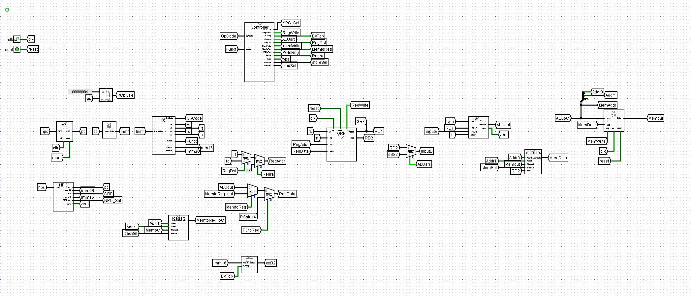
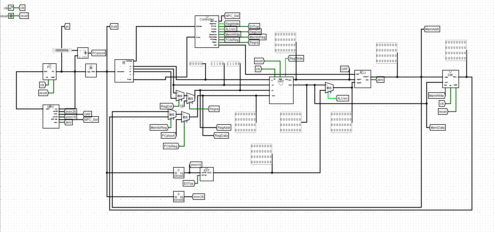

# P4 设计文档
---
# 基于P3的修改
1. 因为verilog可直接切片，所以去掉了IS模块
2. 将storesrc和loadsrc封装进DM模块中
3. 新增CMP模块，集中处理分支跳转指令（ALU模块去掉了zero接口）
   CMP 直接复用 type 信号匹配对应分支判定，配合 zero 控制分支跳转；
4. 二次迭代：给 Controller 新增 zero, rt 输入；拓宽 loadSel storeSel 位宽为 3 位；引入 constants.v 统一管理 type 操作码宏定义，复用 type 驱动 CMP；重新设计多路控制信号，更加直观；
---
# 设计反思
1. 留出足够的位宽，适当写大一位
2. 可以适当穷举所有的数据通路，然后为他们留好控制信号和位宽
---
# 我很容易忘记的事情
1. 位宽不要忘了写；
2. 带符号比较和算术右移两边一定要显式加 $signed；不要忘了无符号会传导，直接给两边同时套上\$signed 就行；
3. Store 类指令和普通 Branch 严禁开启 RegWrite！
---
# 设计草稿

基于P3设计草稿和上述修改，将其转化为verilog代码



---
# 测试方案
```mipsasm
ori $4, $0, 123
lui $6, 123
lui $7, 0xffff
ori $7, $7, 0xffff
add $16, $4, $6
sub $21, $4, $6
add $0, $4, $6

ori $8, $0, 0
sw $16, 0($8)
sw $21, 4($8)
lw $14, 0($8)
sw $14, 8($8)

ori $1, $0, 1
ori $2, $0, 2
beq $1, $2, beq_fail
beq $1, $1, beq_pass

beq_fail:
ori $27, $0, 111
sw $27, 12($8)

beq_pass:
sw $1, 16($8)

j skip_target
ori $26, $0, 222
sw $26, 20($8)

skip_target:
ori $26, $0, 333
sw $26, 20($8)

jal func1
sw $31, 24($8)

jal func2
sw $31, 28($8)

end:
j end

func1:
sw $4, 32($8)
jr $31

func2:
sw $6, 36($8)
jr $31
```
---
# 思考题
1. 阅读下面给出的 DM 的输入示例中（示例 DM 容量为 4KB，即 32bit × 1024字），根据你的理解回答，这个 addr 信号又是从哪里来的？地址信号 addr 位数为什么是 [11:2] 而不是 [9:0] ？
   addr 信号是ALU的计算结果；
   实际实用是按字寻址，addr 必然是4的倍数，后两位必然是0，所以只需要[11:2]就行了
2. 思考上述两种控制器设计的译码方式，给出代码示例，并尝试对比各方式的优劣。
   ```verilog
   assign NPC_Sel = (jal | j) ? 3'b001 :
                    (jr) ? 3'b010 :
                    (beq) ? 3'b011 : 3'b000;
   ```
   使用三目运算符来译码，优势：简洁，易于维护
   劣势：不够直观
3. 在相应的部件中，复位信号的设计都是同步复位，这与 P3 中的设计要求不同。请对比同步复位与异步复位这两种方式的 reset 信号与 clk 信号优先级的关系。
   同步复位：clk > reset
   异步复位: clk < reset
4. C 语言是一种弱类型程序设计语言。C 语言中不对计算结果溢出进行处理，这意味着 C 语言要求程序员必须很清楚计算结果是否会导致溢出。因此，如果仅仅支持 C 语言，MIPS 指令的所有计算指令均可以忽略溢出。 请说明为什么在忽略溢出的前提下，addi 与 addiu 是等价的，add 与 addu 是等价的。提示：阅读《MIPS32® Architecture For Programmers Volume II: The MIPS32® Instruction Set》中相关指令的 Operation 部分。
   ```text
   temp ← (GPR[rs]31||GPR[rs]31..0) + (GPR[rt]31||GPR[rt]31..0)
   if temp32 ≠ temp31 then
       SignalException(IntegerOverflow)
   else
       GPR[rd] ← temp
   endif
   ```
   在忽略溢出的情况下，代码可以直接改写成：
   ```text
   GPR[rd] ← GPR[rs]31..0 + GPR[rt]31..0
   ```
   和addu是等价的
---
# tb模板
```
`timescale 1ns / 1ps

module mips_tb;
    reg clk;
    reg reset;

    mips uut (
        .clk(clk),
        .reset(reset)
    );

    initial begin
        clk = 1'b0;
        forever #5 clk = ~clk;
    end

    initial begin
        reset = 1'b1;
        #20;
        reset = 1'b0;
        #200000;
        $finish;
    end

endmodule
```
---
# 添加各种指令流程
## 流程
1. 判断是哪种类型的指令（R型计算、I型计算、Branch分支、Jump跳转、Load访存、Store存储、条件传送/链接等）；
2. 在 Controller 中添加指令识别 wire 与译码逻辑
3. 配置各项控制信号；
4. 修改数据通路：
   - 需要 ALU 新算子 / 运算来源改变 -> 扩充 ALU.v 并配置 ALU_ASel / ALU_BSel；
   - 需要新分支判断条件 -> 扩充 CMP.v 并在 Controller 中将 type 赋值为该指令宏；
   - 需要特殊访存读写宽度或规则 -> 扩充 DM.v 并配置 loadSel / storeSel；
   - 需要特殊写回目标 -> 配置 RegDst_Sel 和 RegWD_Sel。

---

## 控制信号速查表（重构）

| 控制信号 | 位宽与选择意义 | 基础指令配置与扩展说明 |
|---|---|---|
| `NPC_Sel` | `3'b000` : PC+4（顺序执行）<br>`3'b001` : 26位跳转（`j, jal`）<br>`3'b010` : 寄存器跳转（`jr`）<br>`3'b011` : 16位条件分支（`beq`）<br>`3'b100~111` : 扩展保留 | 默认顺序执行：`3'b000`<br>`j, jal` : `3'b001`<br>`jr` : `3'b010`<br>`beq` : `3'b011`<br>新增分支与跳转按需配置 |
| `RegWrite` | `1` : 写寄存器使能<br>`0` : 禁止写寄存器 | `add, sub, ori, lui, lw, jal` 为 `1`<br>`sw, beq, j, jr` 为 `0`<br>新增条件写指令需结合 `zero` 门控 |
| `RegDst_Sel` | `2'b00` : 写 `rt`<br>`2'b01` : 写 `rd`<br>`2'b10` : 写 `31号寄存器($ra)`<br>`2'b11` : 备用 | `ori, lui, lw` 为 `2'b00`<br>`add, sub` 为 `2'b01`<br>`jal` 为 `2'b10`<br>新增指令按目标寄存器选择 |
| `RegWD_Sel` | `3'b000` : 写回 ALU 运算结果 (`ALUout`)<br>`3'b001` : 写回内存读出值 (`Memout`)<br>`3'b010` : 写回 `PC + 4`（链接返回地址）<br>`3'b011` : 写回当前指令 `pc`<br>`3'b100~111` : 备用 | `add, sub, ori, lui` 为 `3'b000`<br>`lw` 为 `3'b001`<br>`jal` 为 `3'b010`<br>新增写回来源按需扩充 |
| `ALU_ASel` | `2'b00` : 选寄存器 `RD1`<br>`2'b01` : 选移位量 `shamt`<br>`2'b10` : 选当前指令 `pc`<br>`2'b11` : 备用 | 基础10条指令全部默认选 `2'b00`<br>新增需要移位量或PC参与运算的指令按需选择 |
| `ALU_BSel` | `2'b00` : 选寄存器 `RD2`<br>`2'b01` : 选立即数扩展值 `ext32`<br>`2'b10` : 选当前指令 `pc`<br>`2'b11` : 备用 | `add, sub, beq` 为 `2'b00`<br>`ori, lui, lw, sw` 为 `2'b01`<br>新增以PC为第二操作数的指令选 `2'b10` |
| `EXTop` | `1` : 符号扩展（Sign-extend）<br>`0` : 零扩展（Zero-extend） | `lui, lw, sw` 为 `1`<br>`ori` 为 `0`<br>新增算术/访存类填 `1`，逻辑/掩码类填 `0` |
| `MemWrite` | `1` : 写内存使能<br>`0` : 禁止写内存 | 只有 `sw` 为 `1`，其余基础指令全为 `0`<br>新增 Store 类指令填 `1` |
| `storeSel` | `3'b000` : sw (整字)<br>`3'b001` : sh (半字)<br>`3'b010` : sb (单字节)<br>`3'b011~111` : 扩展保留 | 基础指令 `sw` 为 `3'b000`<br>其余基础指令保持默认 `3'b000`<br>新增 Store 类指令按需扩充 |
| `loadSel` | `3'b000` : lw (整字)<br>`3'b001` : lh (有符号半字)<br>`3'b010` : lb (有符号字节)<br>`3'b011~111` : 扩展保留 | 基础指令 `lw` 为 `3'b000`<br>新增 Load 类指令按需分配 `3'b011` 起的编码 |
| `type` | 6位指令类型操作码（在 constants.v 中统一宏定义） | Controller 输出，同时送入 ALU 与 CMP<br>ALU 用于执行算术逻辑计算，CMP 用于识别分支条件判断 |

---

## 各类指令加指令标准配置流程

### 1. B 型分支指令（Branch）
1. 语义：根据条件比较结果决定是否发生 16 位相对跳转（PC = PC + 4 + sign_extend(offset || 00)）。
2. Controller 配置：
   - NPC_Sel = 3'b011
   - type = 对应分支指令的宏（如 `BEQ）
   - ALU_BSel = 2'b00（送入 RD2 供 CMP 比对）
   - 普通 Branch：
     - RegWrite = 0（严禁写寄存器）
   - 带链接 Branch：
     - RegWrite = (zero) ? 1'b1 : 1'b0（只有条件成立时才允许写寄存器）
     - RegDst_Sel = 2'b10（固定写回 31 号寄存器 $ra）
     - RegWD_Sel = 3'b010（写回 PC + 4）
3. 数据通路修改：
   - CMP.v：在 assign zero 中增加一行 ((type == `xxx) && (条件)) ? 1'b1 :

---

### 2. J 型跳转指令（Jump）
1. 各指令对号入座：
   - j（无条件跳转）：
     - NPC_Sel = 3'b001，RegWrite = 0
   - jal（跳转并链接）：
     - NPC_Sel = 3'b001
     - RegWrite = 1
     - RegDst_Sel = 2'b10（写 $31）
     - RegWD_Sel = 3'b010（写 PC + 4）
   - jr（寄存器跳转）：
     - NPC_Sel = 3'b010（目标取自 RD1），RegWrite = 0
   - jalr（寄存器跳转并链接）：
     - NPC_Sel = 3'b010
     - RegWrite = 1
     - RegDst_Sel = 2'b01（写回目标是 rd）
     - RegWD_Sel = 3'b010（写 PC + 4）
2. 数据通路修改：无，仅 Controller 配置即可。

---

### 3. 计算型指令（R 型）
1. 语义：寄存器与寄存器（或移位量/PC）运算，结果写入目标寄存器 rd。
2. Controller 配置：
   - NPC_Sel = 3'b000
   - RegWrite = 1
   - RegDst_Sel = 2'b01（写回 rd）
   - RegWD_Sel = 3'b000（写回 ALUout）
   - ALU_ASel：默认 2'b00（RD1）；固定移位选 2'b01（shamt）；PC 参与运算选 2'b10（PC）
   - ALU_BSel：默认 2'b00（RD2）；PC 作为第二操作数选 2'b10（PC）
   - type：在 constants.v 中新增一行 define 分配新的 ALU 操作码，并在 Controller.v 与 ALU.v 中引用（记得加反引号）
3. 数据通路修改：在 ALU.v 中增加算子并接入 outputA 多路选择器。

---

### 4. 计算型指令（I 型）
1. 语义：寄存器与 16 位立即数运算，结果写入目标寄存器 rt。
2. Controller 配置：
   - NPC_Sel = 3'b000
   - RegWrite = 1
   - RegDst_Sel = 2'b00（写回 rt）
   - RegWD_Sel = 3'b000（写回 ALUout）
   - ALU_ASel = 2'b00（选 RD1）
   - ALU_BSel = 2'b01（选 ext32 立即数）
   - EXTop：算术运算填 1（符号扩展）；逻辑运算/掩码填 0（零扩展）
   - type：分配或复用 ALU 操作码
3. 数据通路修改：在 ALU.v 中增加算子并接入 outputA。

---

### 5. 访存型指令（Load / Store）
1. 共通点：
   - 基地址加偏移量：ALU_ASel = 2'b00, ALU_BSel = 2'b01, EXTop = 1（偏移量符号扩展），type = ADD。
2. Load 类（读内存存入寄存器）：
   - RegWrite = 1
   - RegDst_Sel = 2'b00（写目标寄存器 rt）
   - RegWD_Sel = 3'b001（写回数据来源选择 Memout）
   - MemWrite = 0（严禁写内存）
   - loadSel：3'b000 为 lw，3'b001 为 lh，3'b010 为 lb，扩展指令按需分配编码。
   - 通路修改：在 DM.v 中根据 loadSel 用切片提取对应字节并处理。
3. Store 类（将寄存器数据写入内存）：
   - MemWrite = 1（写内存使能开启）
   - RegWrite = 0（严禁写寄存器）
   - storeSel：3'b000 为 sw，3'b001 为 sh，3'b010 为 sb，扩展指令按需增加。
   - 通路修改：在 DM.v 中按字节掩码局部写入 RAM。

---

### 6. 条件传送 / 条件链接型指令
1. 典型特征：执行与否取决于某个条件的真假。
2. Controller 配置原则：
   - 寄存器写使能必须受条件门控：
     - 当满足条件时写使能为 1，不满足时为 0
   - 将条件判断收敛到 CMP.v 中输出 zero，再作为 Controller 输入直接控制 RegWrite，避免在顶层乱拉胶水线。
---
# 一些知识点
1. for
   在always块中使用for
   其中的变量用reg类型
   模板：
   ```verilog
   integer i;
   always@(*) begin
      //进入循环前必须初始化
      for (i = 0; i ...; i = i + 1) begin
         ...
      end
   end
   ```
2. function
   ```verilog
   function [返回位宽] 函数名(输入端口列表)
   function [31:0] abs_val(input [31:0] data);
      begin
         if (data < 0) begin
            abs_val = -data;//通过把值赋给函数名来实现“return”
         end
         ...
      end
   endfunction
   ```
3. 算数右移
   ```verilog
   $signed(A) >>> 2
   //这里的2保险起见还是加上$signed吧
   ```
4. 切片与掩码的选择
   切片[base +: width] 宽度是固定常数的时候用；
   掩码在提取长度是动态变量的时候用
   造掩码：
   1. 种子：A :32'b1(单点定位和借位减法)  B : 32'hffffffff(整片裁剪)
   2. 造低位n个1:
      种子A左移n位，借位减1 low_mask = (32'b1 << N) - 1
   3. 造高位n个1：
      种子B左移 32 - n 位 high_mask = 32'hffffffff << (32 - N)
   4. [high : low]为1
      len = high - low + 1
      造出低len个1 (32'b1 << len - 1)
      将它整体左移low位 ((32'b1 << Len) - 1) << low
5. bit adder
   ```verilog
   function [31:0] bit_adder;
      input [31:0] in;
      integer k;
      begin
         bit_adder = 0;
         for (k = 0; k < 32; k = k + 1) begin
            bit_adder = bit_adder + in[k];
         end
      end
   endfunction
   ```
   下面这些其实可以用掩码来做吧，不管了先贴在这里
6. 区间比特倒置
   ```verilog
   function [31:0] reverse_range;
      input [31:0] in;
      input [4:0]  high, low;
      integer k;
      begin
         reverse_range = in;
         for (k = 0; k < 32; k = k + 1) begin
            if (k >= low && k <= high) begin
               reverse_range[k] = in[high + low - k];
            end
         end
      end
   endfunction
   ```
7. 区间按位翻转
   ```verilog
   function [31:0] invert_range;
      input [31:0] in;
      input [4:0]  high, low;
      integer k;
      begin
         invert_range = in;
         for (k = 0; k < 32; k = k + 1) begin
            if (k >= low && k <= high) begin
               invert_range[k] = ~in[k];
            end
         end
      end
   endfunction
   ```
