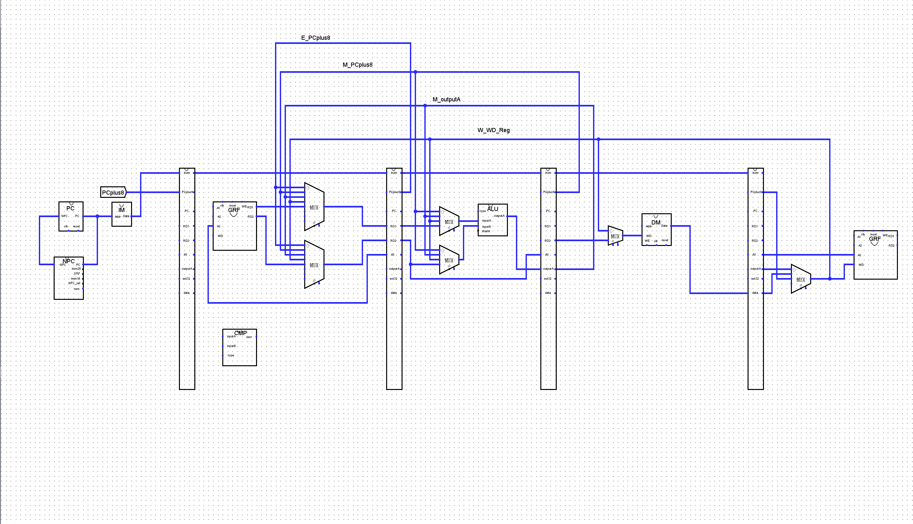
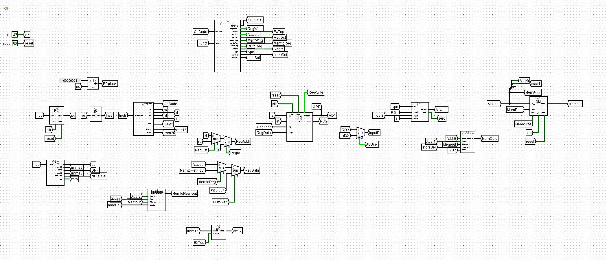

# P5 设计文档
---
# 基于P4的修改
1. 增加了流水线寄存器
   所有流水线都有的控制信号：clk, reset, en, clear
   所有流水线寄存器都流水的数据：Instr, PCplus8, PC 
   1. FDreg
    + 无
   2. DEreg
    + RD1, RD2, A3, ext32
   3. EMreg
    + outputA, RD2, A3
   4. MWreg
    + A3, outputA, data
2. 增加了转发和阻塞的数据通路
   见设计草图
   转发来源：E_PCplus8, M_PCplus8, M_outputA, W_WD_Reg
   转发去路：D_RD1, D_RD2, E_RD1, E_RD2, M_RD2；只有后面的级可以转发到前面的级，加上这些本身共同构成转发结构；
    GRF内部转发

   转发条件 ：
   1. 是否为下一级isPCplus8
   2. 寄存器编号是否为0，转发起点终点是否相同
   3. t_use是否存在
   4. t_new是否存在
   5. t_use是否大于等于t_new
   
   阻塞条件：
   6. 寄存器编号是否为 0
   7. 转发起点和终点寄存器是否相同
   8. t_use 是否存在
   9. t_new 是否存在
   10. t_use 是否小于 t_new
3. AT法与Controller
   在Controller.v中新增了t_rs（何时使用rs）, t_rt（何时使用rt）, t（何时可以转发）
   都是以指令在D级来说的，D -> 0, E -> 1, M -> 2, W -> 3;
   关于t_rs, t_rt，注意是 **使用**，如果是写入的话为4'hf ！
   关于t， 可以转发是要生成数据，然后在下一级流水线可以转发
4. 各类指令AT表

   | 指令大类（参照P4） | 代表指令 | `t_rs` ($T_{use\_rs}$) | `t_rt` ($T_{use\_rt}$) | `t` ($T_{new}$) | 写入目标 $A_3$ | 核心时序说明 |
   | :--- | :--- | :---: | :---: | :---: | :---: | :--- |
   | **1. B 型分支指令** | `beq` (以及扩展 `bne`, `bgtz`, `bltz` 等) | **`4'h0`** | **`4'h0`**<br>(若与0比则为 `4'hf`) | **`4'hf`** | `5'd0` | **D 级 CMP 立即需要**操作数比对；不写寄存器 |
   | **2. J 型跳转指令** | `j`<br>`jal`<br>`jr`<br>`jalr` | `4'hf`<br>`4'hf`<br>**`4'h0`**<br>**`4'h0`** | `4'hf`<br>`4'hf`<br>`4'hf`<br>`4'hf` | `4'hf`<br>**`4'h0`**<br>`4'hf`<br>**`4'h0`** | `5'd0`<br>`5'd31`<br>`5'd0`<br>`rd` | `jr/jalr` **D 级 NPC 立即需要** rs 跳转；<br>`jal/jalr` 的 $PC+8$ 在 D 级即生成，`t=0` 随时可转发 |
   | **3. 计算型指令（R 型）** | `add`, `sub` (以及扩展 `and`, `or`, `slt` 等) | **`4'h1`** | **`4'h1`**<br>(移位指令为 `4'hf`) | **`4'h2`** | `rd` | E 级 ALU 读操作数计算；E 级算完进入 M 级可转发（E级 $T_{new}=1$，M级 $T_{new}=0$） |
   | **4. 计算型指令（I 型）** | `ori`, `lui` (以及扩展 `addi`, `andi` 等) | **`4'h1`**<br>(`lui` 为 `4'hf`) | **`4'hf`** | **`4'h2`** | `rt` | E 级 ALU 读 rs 与立即数计算；`rt` 是写入目标，不读取 |
   | **5. 访存型指令（Load）** | `lw` (以及扩展 `lh`, `lb` 等) | **`4'h1`** | **`4'hf`** | **`4'h3`** | `rt` | E 级算地址，M 级读内存，到 W 级才可转发数据（E级 $T_{new}=2$，M级 $T_{new}=1$） |
   | **6. 访存型指令（Store）** | `sw` (以及扩展 `sh`, `sb` 等) | **`4'h1`** | **`4'h2`** | **`4'hf`** | `5'd0` | E 级算地址；**`rt` 到 M 级存入内存才需要**；不写寄存器 |
   | **7. 条件类 / 特殊指令** | `movz`（未定写使能）<br>`bltzal`（条件链接） | `4'h1`<br>`4'h0` | `4'h1`<br>`4'hf` | `4'h2`<br>`4'h0` | 动态 `rd` / 0<br>动态 31 / 0 | 条件成立时正常写，条件不成立时通过“A3置零法”关闭写入 |

---
# 思考题
1、我们使用提前分支判断的方法尽早产生结果来减少因不确定而带来的开销，但实际上这种方法并非总能提高效率，请从流水线冒险的角度思考其原因并给出一个指令序列的例子。
   分支判断提前是为了减少控制冒险，然而提前到D级对操作数寄存器的需求时间大大提前，可能会加重阻塞
   例子：
   ```
   add $1, $2, $3
   beq $1, $0, lable
   lable:
   ```
2、因为延迟槽的存在，对于 jal 等需要将指令地址写入寄存器的指令，要写回 PC + 8，请思考为什么这样设计？
   有延迟槽时，jal并不会立即跳转，而是会先执行pc+4后再跳转，因此真正的下一条未被执行的指令是pc+8。
3、我们要求大家所有转发数据都来源于流水寄存器而不能是功能部件（如 DM 、 ALU ），请思考为什么？
   防止时钟关键路径过长。如果直接从功能部件转发，转发的时候已经是周期末尾了，可能会导致转发出错或CPU频率下降；如果从流水线寄存器转发则不会出现这个问题
4、我们为什么要使用 GPR 内部转发？该如何实现？
   W级指令向GRF中写入数据，若此时D级指令在同一个周期内尝试读取GRF而且是相同的寄存器，就会产生冒险，使用内部转发可以简单高效的解决冒险；
   实现：
   ```
   assign RD1 = (A1 == 5'd0) ? 32'd0 :
             (WE && (A1 == A3)) ? WD : GRF[A1];
   assign RD2 = (A2 == 5'd0) ? 32'd0 :
             (WE && (A2 == A3)) ? WD : GRF[A2];
   ```
5、我们转发时数据的需求者和供给者可能来源于哪些位置？共有哪些转发数据通路？
   需求者：D 级：D_RD1（CMP 比较、JR 跳转）、D_RD2（CMP 比较）；E 级：E_RD1（ALU 操作数 A）、E_RD2（ALU 操作数 B）；M 级：M_RD2（DM 写入数据端口 WD，如 sw, sh, sb）
   供给者：E 级寄存器：E_PCplus8（jal 等链接指令已生成的返回地址）；M 级寄存器：M_outputA（ALU 运算结果）、M_PCplus8（链接返回地址）；W 级寄存器：W_WD_Reg（包含 DM 读出数据、ALU 结果、PCplus8 等最终写回数据）
   数据通路：由上述供给者->需求者排列组合而成，再加一条GRF内部转发
6、在课上测试时，我们需要你现场实现新的指令，对于这些新的指令，你可能需要在原有的数据通路上做哪些扩展或修改？提示：你可以对指令进行分类，思考每一类指令可能修改或扩展哪些位置。
   1. 计算型指令（R/ I）
      ALU
   2. 分支跳转型指令（B/ J）
      CMP
   3. 访存型指令（load/ store）
      DM
   
7、确定你的译码方式，简要描述你的译码器架构，并思考该架构的优势以及不足。
   采用的是分布式译码，在各级流水线分别实例化一个独立的Controller。优势：扩展性强，顶层连线清晰，不用复杂流水；劣势：硬件开销大
---
# 命名规则
1. 级数_信号名：例如D_Instr...
2. 用下划线作分割
---
# 设计草稿


(下面是P4设计草图)


---
# 三种常见题型加指令流程
## 清空延迟槽
1. CMP 10 14
2. mips 310-318 634

一般出现在B型分支跳转指令中，满足条件则跳转，延迟槽正常执行；不满足条件不跳转，延迟槽指令被清空

做以下修改
在CMP.v中新增一个信号`nullify`
`nullify = (type == xx) && !zero`
mips.v 新增防自杀门控：`fixed_nullify`
```
assign fixed_xx_nullify = xx_nullify && (~D_stall)
assign FD_clear = (fixed_xx_nullify) ? 1 : 0
```

## 未定写使能
1. mips 320-332 / 374-386

采用A3置零法，若不满足写入条件则将A3置零；

在 RegWrite 中直接添加`xx`，然后判断在哪里能计算出到底写还是不写，然后在对应计算器中新增一个信号`xx_we`，然后对对应计算器对应级的A3进行fixed
```
wire [4:0] D_fixedA3;
assign D_fixedA3 = (D_type == xx && !xx_we) ? 5'd0 : D_A3;
DEreg DEreg(...  .D_A3(D_fixedA3)...)
```
这里是以D级为例，对应级对应修改（还有下一级流水线寄存器）

## 未定写寄存器
1. mips 430-440 646

一般出现在load类指令中，这里就直接以M级来写了吧
修正M_A3； 阻塞想读取欲写入寄存器的指令
```
wire [4:0] dynamic_A3 = (condition) ? 寄存器1 : 寄存器2;
wire [4:0] M_fixedA3 = (M_type == xx) ? dynamic_A3 : M_A3;
MWreg MWreg ( ... .M_A3(M_fixedA3), ... );

// condition(寄存器) 表示目标寄存器满足的条件
assign D_stall = 
    (E_type == xx && D_rs != 5'b00000 && D_t_rsuse != 4'hf && condition(D_rs)) ? 1'b1 :
    (E_type == xx && D_rt != 5'b00000 && D_t_rtuse != 4'hf && condition(D_rt)) ? 1'b1 :
    (E_type != xx && E_A3 != 5'b00000 && D_rs == E_A3 && D_t_rsuse != 4'hf && E_t_new != 4'hf && D_t_rsuse < E_t_new) ? 1'b1 :
    (E_type != xx && E_A3 != 5'b00000 && D_rt == E_A3 && D_t_rtuse != 4'hf && E_t_new != 4'hf && D_t_rtuse < E_t_new) ? 1'b1 :
    (M_fixedA3 != 5'b00000 && D_rs == M_fixedA3 && D_t_rsuse != 4'hf && M_t_new != 4'hf && D_t_rsuse < M_t_new) ? 1'b1 :
    (M_fixedA3 != 5'b00000 && D_rt == M_fixedA3 && D_t_rtuse != 4'hf && M_t_new != 4'hf && D_t_rtuse < M_t_new) ? 1'b1 :
    (W_A3 != 5'b00000 && D_rs == W_A3 && D_t_rsuse != 4'hf && W_t_new != 4'hf && D_t_rsuse < W_t_new) ? 1'b1 :
    (W_A3 != 5'b00000 && D_rt == W_A3 && D_t_rtuse != 4'hf && W_t_new != 4'hf && D_t_rtuse < W_t_new) ? 1'b1 :
    1'b0;
```

## 条件写入数据
写入数据根据条件决定，以M级为例；
```
wire [31:0] xx_res;
assign xx_res = ();
wire [31:0] M_fixeddata;
assign M_fixeddata = (M_type == ) ? xx_res : M_data;

//M级流水线寄存器的相应接口也要修改
```

## 冒泡排序
对4个数进行冒泡排序，这里以inputA的四个字节为例，排序结果是让最大值浮到b3,最小值为b0；
```
reg [7:0] b0, b1, b2,b3;
reg [7:0] tmp;
always@(*) begin
   b0 = inputA[7:0];
   // b1 = , b2 = , b3 =
   
    // [第 1 轮] 将最大值冒泡浮动到 b3
    if (b0 > b1) begin t = b0; b0 = b1; b1 = t; end
    if (b1 > b2) begin t = b1; b1 = b2; b2 = t; end
    if (b2 > b3) begin t = b2; b2 = b3; b3 = t; end
    // [第 2 轮] 将次大值冒泡浮动到 b2
    if (b0 > b1) begin t = b0; b0 = b1; b1 = t; end
    if (b1 > b2) begin t = b1; b1 = b2; b2 = t; end
    // [第 3 轮] 确定 b0 和 b1 的最终顺序
    if (b0 > b1) begin t = b0; b0 = b1; b1 = t; end
end
```

## 循环移位
wire [63:0] double_data = {inputA, inputA};
wire [31:0] ror_res;
assign ror_res = double_data >> sh;
wire [63:0] rol_shifted = double_data << sh;
wire [31:0] rol_res = rol_shifted[63:32];
---
# 测试方案
```
 // 基础数据初始化
ori $1, $0, 1
ori $2, $0, 2
lui $3, 0x1234
ori $3, $3, 0x5678

// 1. 测试alu计算与前推(距离1, 距离2, 距离3)
add $4, $1, $2        // $4 = 3
sub $5, $4, $1        // 紧跟上条读$4, 距离1转发(E->E)
ori $6, $5, 4         // 紧跟上条读$5, 距离1转发(E->E)
lui $7, 0x0001
add $8, $7, $6        // 间隔1条读$6, 距离2转发(M->E)
add $9, $4, $0        // 间隔多条, 测试W级写优先/内部转发

// 2. 测试load-use冒险(检查是否正确阻塞1拍)
sw  $3, 0($0)
lw  $10, 0($0)
add $11, $10, $1      // lw后紧跟读$10, 必须stall 1拍

// 3. 测试store数据前推
add $12, $1, $2       // E级算出$12
sw  $12, 4($0)        // 紧跟sw, 测试向M级WD前推
lw  $13, 4($0)

// 4. 测试branch冒险与延迟槽
// 4.1 alu紧跟beq(D级需要数据, 必须stall 1拍)
ori $14, $0, 10
add $15, $14, $0
beq $15, $14, label1
ori $16, $0, 0x1111   // 延迟槽指令, 必须执行

fail1:
beq $0, $0, fail1
nop

label1:
// 4.2 lw紧跟beq(必须连续stall 2拍)
sw  $2, 8($0)
lw  $15, 8($0)
beq $15, $2, label2
ori $16, $0, 0x2222   // 延迟槽指令, 必须执行

fail2:
beq $0, $0, fail2
nop

label2:
// 5. 测试jal/jr与延迟槽中的$31转发
jal func
ori $17, $31, 0       // 延迟槽读$31, 测试PCplus8立即前推

loop:
beq $0, $0, loop
nop

func:
ori $18, $0, 100
jr  $31
ori $19, $0, 200      // jr延迟槽, 返回前必须执行
```

```
// 1. 测条件满足: 跳转 + 延迟槽执行 + 链接写$31
ori $31, $0, 0x1111     // 初值
new_branch $0, target1  // 假设满足跳转
ori $1, $0, 0x2222      // 延迟槽: 执行后$1应为0x2222

fail1:
beq $0, $0, fail1
nop

target1:
// 此时看仿真: $31应为PC+8, $1应为0x2222

// 2. 测条件不满足: 不跳 + 作废延迟槽 + 不链接
ori $31, $0, 0x1111     // 重置初值
ori $2, $0, 0x3333
new_branch $4, fail2    // 假设不满足条件, 顺序往下走
ori $2, $0, 0x4444      // 延迟槽: 若作废, $2绝不能变成0x4444!

// 此时看仿真: $31应保持0x1111, $2应保持0x3333
```

```
// 1. 测计算是否正确
ori $1, $0, 5
new_alu $2, $1, 10      // 算完看仿真$2是不是预期值

// 2. 测条件不满足时不写回
ori $3, $0, 0x1234      // 预置初值
new_alu_cond $3, $1     // 假设此条件不满足写回
// 看仿真: $3是否依然保持0x1234原值
```

```
// 1. 存入测试数据
ori $1, $0, 10
sw  $1, 0($0)

ori $2, $0, 0xaaaa      // 备选目标1
ori $3, $0, 0xbbbb      // 备选目标2

// 2. 测动态写回
new_load $2, 0($0)      // 执行完看仿真: 哪个寄存器被写入新值, 另一个是否保持原值
```
---